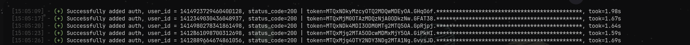

# Discord OAuth Adder

A Python tool that mass authorizes Discord tokens via OAuth2 to capture access and refresh tokens for the `identify` and `guilds.join` scopes.It uses `curl_cffi` for HTTP requests and automatically spoofs browser-related headers to mimic a Chrome 145 client.

## Preview



## What it does

* **Mass Authorization:** Runs through a list of tokens and authorizes them via Discord's OAuth2 flow.
* **Token Capture:** Runs a local Flask server to catch the callback and saves `user_id:access_token:refresh_token` to `i.txt`.
* **Browser Headers:** Builds `sec-ch-ua`, `x-super-properties` and other headers from the User-Agent in `config.json`.
* **Token Support:** Reads Discord tokens from `token.txt`, supporting colon-separated formats.
* **Per-token timing:** Shows how long each authorization request takes.
* **Simple output:** Reports successful callbacks and failed requests with their status codes.

The script runs through the tokens once and exits.

## Setup

### 1. Install the requirements

```bash
pip install flask python-dotenv requests curl_cffi colorama
```

### 2. Project structure

```text
oauth-adder/
├── config.json
├── token.txt
├── .env
├── helpers/
│   ├── config.py
│   ├── header.py
│   ├── session.py
│   └── log.py
├── main.py
└── server.py
```

### 3. Configure your User-Agent and App

`config.json`:

```json
{
  "useragent": "Mozilla/5.0 (Windows NT 10.0; Win64; x64) AppleWebKit/537.36 (KHTML, like Gecko) Chrome/145.0.0.0 Safari/537.36",
  "client_id": "YOUR_APP_CLIENT_ID",
  "redirect_url": "http://localhost:5000/callback",
  "response_type": "code",
  "scope": "identify guilds.join"
}
```

The Chrome version is extracted from the User-Agent and used when generating the browser-related headers. Make sure the impersonate value matches the Chrome version in your User-Agent.

### 4. Setup Environment

Create a `.env` file for the callback server:

```env
DISCORD_CLIENT_ID=your_client_id
DISCORD_CLIENT_SECRET=your_client_secret
DISCORD_BOT_TOKEN=your_bot_token
DISCORD_REDIRECT_URI=http://localhost:5000/callback
```

### 5. Add your tokens

`token.txt` supports either a plain token:

```text
your token
```

or a colon-separated format where the token is the last field:

```text
email:pass:YOUR_TOKEN
```

**Never share `token.txt` or `.env`**

## Running

1. Start the callback server:

```bash
python server.py
```

2. Run the authorizer in a separate terminal:

```bash
python main.py
```

A successful update looks like:

```text
[HH:MM:SS] - (+) Successfully added auth, user_id = 1234567890, status_code=200, took=1.45s
```

The token is partially hidden in the console output.

## Response codes

| Code  | Meaning                     |
| ----- | --------------------------- |
| `200` | Authorized successfully     |
| `400` | Bad request                 |
| Other | Request failed              |

The response body is printed for unsuccessful requests to help with debugging.

## Notes

* The authorize payload in `main.py` uses hardcoded placeholder values (`10000`) for `guild_id`, `channel_id`, and `channel_type`. Replace these with your target IDs if needed.
* Grease, `x-super-properties`, and other headers are dynamically generated per request.
* Keep your `token.txt` and `.env` private.
* Don't paste your token when reporting an issue.
## Rules

* Don't copy the project, rename it, and claim you made it.
* Don't sell or paywall the project.
* Use it only with accounts you own or are authorized to manage.
* If you use parts of the code, give credit and link back to [this repository](https://github.com/NoTinyxd/oauth-adder).

## Disclaimer

This project is provided for educational purposes. Use it at your own risk. The author isn't responsible for account restrictions, loss of access, or other consequences resulting from its use.

## ☕ Donations

This project is free. If it saved you some time and you want to support it, LTC is appreciated:

```text
LXdgPhE4UfVUgtfXkT7wR1T4Jxam9sCsbb
```
